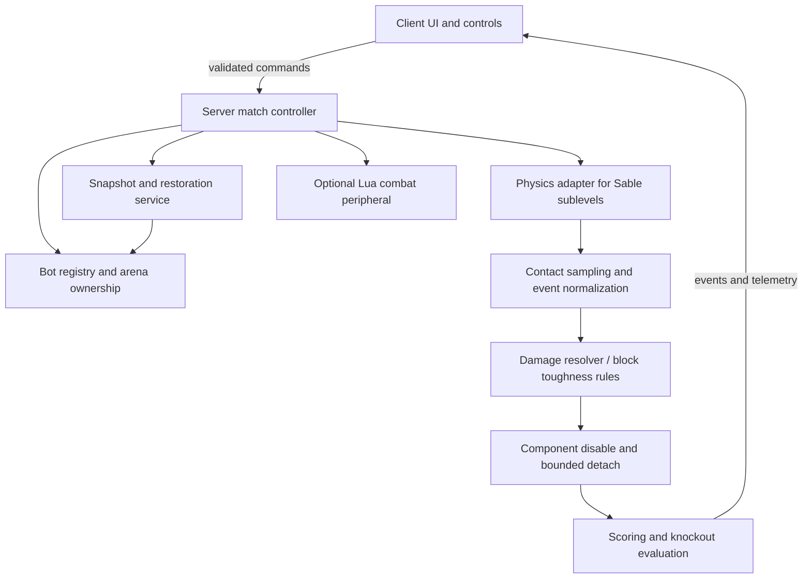

# Create: Battle Bots — Technical Design and Implementation Plan

**Version:** 0.1 — 30 October 2026
**Status:** Design specification; code and gameplay integration not yet implemented or tested.
**Target:** Public Minecraft Create add-on and Poiesis Education tournaments.

## 1. Product decisions (confirmed)

1. **Robots:** Ground, aerial, and walking creations, including mixed-form machines.
2. **Controls:** Both human piloting and programmable automation, with separate competitive ladders.
3. **Damage:** Controlled destruction of parts, visually obvious consequences, automatic restoration after a match.
4. **Construction:** Almost unrestricted Create engineering. No fixed chassis, prescribed weapon kit, or universal size cap in free-build mode.
5. **Audience:** General Minecraft modding community plus educational club sessions.

**Design rule:** The physics engine decides movement and contact. Battle Bots applies tournament rules and server-authoritative consequences to those events.

## 2. Intended player experience

**Build → assemble → register → test → fight → inspect → restore → iterate.**

Players build with ordinary Create/Simulated/Aeronautics/Offroad machinery. A small *Battle Transponder* block associates one assembled machine with a team, competitor, and blueprint; it does not prescribe shape or movement. A *Garage Console* launches practice or formal matches. A *Battle Arena Controller* defines a protected arena, spawn positions, and match rules. An *Engineering Goggles* view reports hit locations, component failures, velocity, spin speed, and other useful measurements.

Examples:
- A low wedge pushes a spinning robot against the wall; the spinner loses its drive shaft.
- A flying machine uses thrust to dodge a hammerbot but becomes vulnerable while landing.
- A walking robot's front leg actuator is disabled, forcing a limp rather than subtracting generic hit points.
- An autonomous robot uses radar and Lua rules to keep distance, wait for a charging opponent, then counterattack.

A normal player should be able to win without coding. A student should be able to write meaningful controller code without mastering the entire physics API.

## 3. Game modes and fair competition

| Mode | Build freedom | Pilot | Scoring |
|---|---|---|---|
| Open Workshop | Unrestricted | Human or AI | No formal score |
| Open Rumble | Almost unrestricted | Human | Knockout / time-limit judges |
| Autonomous League | Almost unrestricted | Programmed | Knockout / time-limit judges |
| Class Championship | Optional event limits | Human or AI, separate brackets | Division score |
| Engineering Trials | Challenge-dependent | Human or AI | Measured performance |

**Machine classes are labels, not chassis restrictions.** Ground, aerial, and walking divisions use registration-time classification and referee confirmation; hybrid machines are allowed in Open Rumble. Do not attempt infallible automatic gait classification for the first release.

Formal-match rules: best-of-three optional, 3-minute configurable round default, 1v1 at launch, no block placement after the countdown, team ownership enforcement, and arena-confined combat damage. Optional tournament tiers may limit total block count, loaded objects, weapon RPM, energy budget, and mass. These are tournament settings, not global construction constraints. The server enforces separate computational safety ceilings.

Win states:
- **KO:** core transponder destroyed or detached from controllable structure, or no meaningful control/propulsion for a configured timeout while a bot is commanded to move; avoid classifying intentional stationary tactics as a KO.
- **Ring-out:** physical robot leaves the permitted arena volume (if enabled).
- **Technical KO:** unrecoverable assembly/physics fault, or player disconnect subject to reconnect grace period.
- **Decision:** damage effectiveness, arena control, aggression; publish per-factor totals.
- **Draw:** both bots disabled simultaneously or exact equal decision score.

## 4. Required and optional technology

### Baseline
- Java 21, Minecraft Java 1.21.1, NeoForge 21.1.x.
- Create 6.0.10, Simulated, Aeronautics, Offroad, and Sable, using a version combination tested together.
- Start from the official Simulated Project source/dependency setup. Its current `gradle.properties` reports version 1.3.2, Sable `2.0.4-37`, Create `6.0.10-280`, Java 21, and NeoForge `21.1.247`; treat these as **build-reference coordinates**, not proof of a compatible released pack.

### Optional integration
- **CC: Tweaked + Create: Avionics:** advanced Lua sensors and actuator control; expose Battle Bots' own combat telemetry as an additional peripheral.
- **CC: Sable:** existing physics-object sensing for in-game computers.
- **Gadgets & Gizmos:** joystick, servo, bearing, and thruster builds; do not require or copy its proprietary source.
- **Create Aeronautics: Toolgun:** optional user-side blueprint workflow; do not copy its noncommercial licensed implementation. Build reliable native snapshots for match restoration.
- **Sable Collision Damage / Sable True Impact:** research references and optional compatibility targets, **not default dependencies**. Disable overlapping damage handling within the arena where supported; otherwise mark incompatible configurations in diagnostics. Both existing damage projects describe unfinished or experimental behavior.

### Licensing checkpoint
Before distributing publicly or commercially, verify the **Simulated Project custom license**, Sable license, and all bundled dependencies. Public permission to install an add-on does not authorize copying its source or art. Prefer code written directly against supported APIs and license-compatible libraries.

## 5. Architecture



### Packages / modules

```text
src/main/java/education/poiesis/createbattlebots/
  CreateBattleBots.java
  registry/          # Deferred registers, blocks, items, events
  config/            # Server safety, rules, default values
  compat/
    sable/           # Sublevel refs, transformations, physical state
    create/          # Stress, rotation, Create block integration
    computercraft/   # Optional peripheral service + events
    gadgets/         # Optional detection only
  bot/
    BotIdentity.java
    BotRegistry.java
    BotTopology.java
    BotSnapshot.java
  arena/
    ArenaDefinition.java
    ArenaManager.java
    ArenaProtection.java
  match/
    MatchState.java
    MatchController.java
    MatchRules.java
    MatchScore.java
  combat/
    CombatContact.java
    ImpactNormalizer.java
    DamageResolver.java
    StructuralDamage.java
    PartFailure.java
  repair/
    SnapshotService.java
    RestoreService.java
    RestoreVerifier.java
  network/           # Versioned packets + validation
  client/            # HUD, garage GUI, replay visual markers
  command/           # /battlebots ...
  data/              # SavedData records and datapack tags
src/test/java/...    # Pure-rule unit tests, simulation harnesses
src/gametest/java/...# NeoForge GameTests where practical
```

### Physics adapter contract (conceptual Java, not confirmed upstream method signatures)

```java
interface PhysicsBotAdapter {
    Optional<PhysicsBot> resolveFromTransponder(ServerLevel level, BlockPos pos);
    Pose readWorldPose(PhysicsBot bot);
    Motion readMotion(PhysicsBot bot);
    Set<PhysicsPart> enumerateParts(PhysicsBot bot);
    List<ContactSample> drainContacts(ArenaId arena);
    Result disablePart(PhysicsBot bot, PartId part);
    Result despawnSafely(PhysicsBot bot);
    Result spawnFromSnapshot(BotSnapshot snapshot, Pose spawnPose);
}
```

A Sable vessel is a `SubLevel`, not an Aeronautics-only ship entity. A third-party add-on reports APIs including `ServerSubLevel`, `SubLevel.logicalPose()`, `LevelPlot.getBoundingBox()`, `getMassTracker()`, and `BlockEntitySubLevelActor.sable$tick(ServerSubLevel)`. **These are verified as examples in that add-on's documentation, not guaranteed stable public contracts.** Check signatures against the exact pinned Sable/Aeronautics binaries before implementing.

Identity rules:
- Store an immutable bot UUID, owner/team, current match ID, and original snapshot ID in server-level saved data.
- Maintain an index from every registered Sable sublevel / child sublevel to bot UUID. Update the index on assembly, split, weld, detach, and deletion.
- Never trust a client-supplied block position or UUID without checking world, proximity, ownership, match phase, and server truth.
- World coordinates and sublevel-local coordinates must be explicitly distinguished in type names to prevent incorrect hits and restorations.

## 6. Combat physics and damage

### Contacts

**Critical integration spike:** identify whether the pinned Sable build exposes collision contact/impulse data to add-ons. If no suitable supported event exists, prototype a single narrowly scoped adapter or a conservative near-contact sampler, then evaluate accuracy and performance. Avoid assuming NeoForge's ordinary entity collision events cover Sable-to-Sable block contacts.

A normalized contact records: match ID, two bot IDs, world-space contact point/normal, local blocks/parts hit, relative velocity, weapon-tip velocity if rotating, estimated transferred impulse, and tick. The authoritative server deduplicates repeated contacts and applies rate limits. Only physics/contact observation may run in a physics callback. World edits and block-entity mutations must be queued onto the safe game thread after verifying the threading model.

### Damage model

Use impact energy as a **scoring proxy**, not a claim of exact finite-element simulation:

`E_proxy = 0.5 * effective_mass * max(0, closing_speed)^2`

A rotating blade can contribute approximate tip speed `omega * radius`. Normalize the result by material toughness, contact geometry, weapon tags, protection rules, and a per-hit maximum. Give blocks data-driven properties via datapack tags / JSON entries so vanilla, Create, and third-party blocks can be classified without hardcoding every block ID. Values must be configurable and visible to creators.

Proposed states:
1. **Healthy**: ordinary operation.
2. **Damaged**: visual feedback, optional reduced efficiency.
3. **Disabled**: bearing stalls, propulsion loses power, or control circuit is severed.
4. **Destroyed**: a bounded number of blocks are removed or replaced with debris, and any disconnected clusters are handled by a controlled detach policy.

First release: limit actual destruction to a small, configurable number of blocks per server tick. Prefer failure states and visual debris over recursively creating hundreds of new physics objects. Never destroy normal terrain or outside-arena blocks. Self-hits, friendly fire, explosions, heat, and projectiles are explicit separate policies, not implicit deductions from physics.

### Scoring

- Damage points from verified opponent-caused component failures.
- Control points from sustained effective displacement/position, not raw proximity.
- Aggression from purposeful engagements while respecting cooldowns; don't reward repeatedly scratching a wall.
- A bot must be able to win with pushes and ring-outs even without a dedicated weapon block.
- All decisions emit an auditable match event log.

## 7. Automatic repair: a core requirement, not polish

**Prepare the restore snapshot immediately before battle**, after the whole bot is assembled and validated in a protected staging zone. Capture all related sublevels and child assemblies, block states, block-entity NBT, inventories where permitted, attachment constraints, orientation, and relevant mod-specific state. Because Create networks and Sable sublevels are complicated, test this exhaustively with a deliberately tiny bot before implementing fancy weapons.

Restoration sequence:
1. Pre-match: verify ownership and capture a snapshot checksum. Persist it in a versioned server record before countdown.
2. During battle: mark mutated entities/sublevels and damage events; never edit the original snapshot.
3. End: stop inputs and kinetic effects, dismount passengers, clear projectiles, then safely retire **all** registered bot bodies and fragments.
4. Restore in the protected garage at a validated collision-free spawn pose, reconstructing assemblies and constraints in the upstream-supported order.
5. Validate block/attachment counts and important state hashes; if invalid, leave the bot in a safe, disabled recovery state and show an actionable error.
6. Clean up only temporary match-owned entities and world changes. Never erase nearby players' ordinary blocks or inventories.
7. Keep backup snapshots and allow a moderator to retry recovery; store sufficient crash-recovery metadata.

**Acceptance test:** A spinner with two moving substructures can lose a wheel and a shaft, be reset 20 consecutive times, and return with the same design, inventories, connectivity, and placement, without duplicate blocks or orphan physics objects.

## 8. Programming / autonomous competitions

Expose optional combat-specific APIs through CC: Tweaked rather than writing an entirely new Lua runtime. Let existing Avionics and CC: Sable tools handle navigation and physics where installed. Proposed **new** peripheral methods (not existing API methods):

```lua
local match = peripheral.find("battle_transponder")
print(match.getState())         -- "practice", "countdown", "active", "ended"
print(match.getTimeRemaining()) -- seconds
print(match.getMyDamage())      -- structured component summary
print(match.getScore())         -- official judging totals
local contacts = match.getRecentHits()

-- Existing CC/Avionics peripherals can steer, throttle, and operate actuators.
-- Battle Bots supplies combat status; it does not grant unbounded world control.
```

During autonomous matches, computers remain installed on the physical bots, subject to the same physics and component damage as human pilots. Server rate limits prevent scripts from spamming requests. Require approved methods only; no filesystem/HTTP/network bridge privileges from the new peripheral. Do not classify a bot as autonomous merely because it has a computer: a match-specific control lock should prevent manual piloting during an AI bracket.

### Educational fit

Optional diagnostics show speed, acceleration, turning radius, weapon RPM, energy consumption, repeated damage sources, and stability over time. A pre-match prediction prompt and post-match graphs can support lessons on momentum, feedback control, mechanics, coding, and iterative design. The HUD defaults to a simple fun-first view; no mandatory quizzes or lectures.

## 9. Development order and gates

| Phase | Deliverable | Required proof |
|---|---|---|
| **0. Compatibility spike** | Minimal NeoForge add-on loads pinned Create/Simulated/Aeronautics/Offroad/Sable stack | `gradlew build`, client startup, dedicated-server startup |
| **1. Physics adapter** | Detect, register, track one assembled ground bot | Accurate position, body IDs, child structure mapping |
| **2. Snapshot + restore** | Assemble, save, retire, re-create one bot | 20 consecutive successful resets; no dupes |
| **3. Arena lifecycle** | Garage console, start countdown, ownership, arena bounds, two human pilots | Match starts/ends/restarts deterministically |
| **4. Simple damage** | Two bots can ram, lose designated components, and restore | Contact attribution correct; protected world unaffected |
| **5. Weapons** | Rotating spinner, flipper, wedge, hammer test builds | Hits scale meaningfully and obey caps |
| **6. Vertical combat** | Flying bots and mixed aerial/ground arena | Consistent hit transforms and safe ring-out |
| **7. Walking machines** | Test jointed walkers and damaged legs | Reliable registration, no forced chassis |
| **8. AI league** | CC: Tweaked peripheral, autonomous match locks | Scripted 1v1 finishes without manual control |
| **9. Public polish** | Configs, translations, Ponder scenes, spectator HUD, replay summaries, matchmaking | Clean dedicated-server smoke test; modpack safety tests |

**Important:** Phase 2 comes before advanced damage. Restoring machines reliably is the prerequisite for a fun iterative combat loop. Building complex weapons before that would create avoidable world-corruption and testing costs.

### First vertical slice (definition of done)

- Two player-made wheeled machines with unique transponders.
- A rectangular protected arena with two spawn pads and one garage station.
- Human controls work in multiplayer; damage cannot modify nonregistered structures.
- Robot A can ram Robot B; the hit produces a clear, server-authoritative effect.
- A configured part can fail; the damaged bot shows meaningful loss of function.
- Match ends on explicit KO, ring-out, timeout, or surrender.
- Both machines are automatically restored without manual rebuilding.
- A dedicated-server test with two clients completes several rounds without creating orphan sublevels.

## 10. Test strategy

**Pure unit tests:** damage formula monotonicity, material multipliers, hit cooldown, point aggregation, KO state machine, tie handling, damage caps, packet validation, snapshot version migration.

**GameTests / integration:** transponder registration, assembler interaction, local/world coordinate transforms, sublevel ownership, block-entity preservation, no terrain damage, reload/reconnect, dedicated-server lifecycle.

**Manual physics tests:** head-on ram, sideways scrape, spinning weapon against wedge, simultaneous hit, stationary contact, leg detachment, flight-to-ground impact, fast rotating assemblies, Sable body split/weld, disconnection mid-match, TPS drop, server restart during restoration.

**Compatibility matrix:** start with one known-good pinned minimal modpack; separately test Avionics, CC: Sable, Gadgets & Gizmos, Toolgun, and collision mods. Never enable two damage engines in the same tournament until behavior is explicitly tested.

**Performance instrumentation:** per-tick time spent in contact collection, damage resolution, structural traversal, and restore; number of active bodies/fragments; packet rates; arena-local block mutations. Configure server safety ceilings and reduce effect fidelity before compromising simulation correctness.

## 11. Open technical questions (verify by proof, not assumption)

1. Does pinned Sable provide stable contact manifolds/impulse callbacks for two sublevels and world geometry?
2. Can a constrained sublevel hierarchy be snapshotted and reconstituted through upstream supported functions, including complex block entities?
3. Does detaching a piece produce a valid independent physics structure, or should it remain a disabled attached part in v1?
4. Which offroad/flying/control components are serializable when restored from an off-world snapshot?
5. How do CPU/physics costs scale when many rotating contact surfaces are involved?
6. Which compatible versions of Avionics and optional add-ons are usable with the pinned core stack?
7. What modifications and redistribution are allowed by the full Simulated Project and Sable license texts?

If collision events or snapshot restoration are infeasible within the chosen stack, pivot the first version to **registered hit zones + bounded component disable** while keeping normal Aeronautics movement and match orchestration. Do not replace the physics engine.

## 12. Sources / development references (checked 2026-10-30)

1. Official Create Aeronautics project: https://modrinth.com/mod/create-aeronautics
2. Official Simulated Project repository: https://github.com/Creators-of-Aeronautics/Simulated-Project
3. Official Gradle version pins: https://github.com/Creators-of-Aeronautics/Simulated-Project/blob/main/gradle.properties
4. Example Sable SubLevel integration: https://github.com/ICEconchy/Aerowarptics
5. CC and avionics integration: https://github.com/SolAstrius/CreateAvionics and https://solastrius.github.io/CreateAvionics/
6. CC: Sable: https://modrinth.com/mod/cc-sable
7. Gadgets & Gizmos: https://modrinth.com/project/create-aeronautics-gadgets-and-gizmos
8. Toolgun blueprint utility (reference only): https://github.com/userenxv/create-aeronautics-toolgun
9. Experimental collision damage: https://modrinth.com/mod/sable-create-aeronautics-collision-damage
10. Experimental True Impact: https://modrinth.com/mod/sable-true-impact

---

**Recommended immediate next step:** create a new branch/repo with a minimal mod, prove one Sable bot can be registered, snapshotted, removed, and restored on a dedicated server. Do not begin with a full weapon system.
